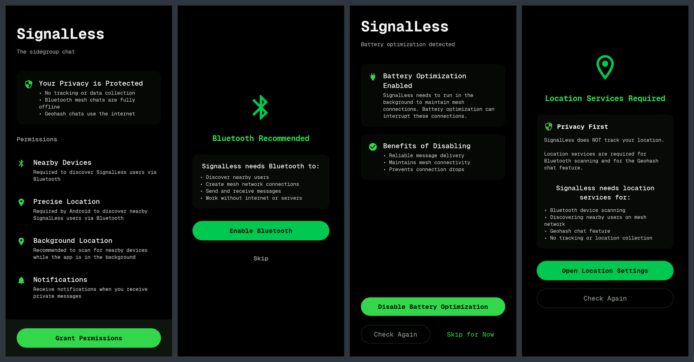

<div align="center">


# SignalLess for Android

**Messaging that works without a network.**<br>
Offline-first, peer-to-peer chat over a Bluetooth mesh. No accounts, no phone numbers, no central servers.

[](https://github.com/akshad-exe/signalless-android/releases/latest)
[](https://github.com/akshad-exe/signalless-android/actions/workflows/android-build.yml)
[](LICENSE.md)


[**Download**](https://github.com/akshad-exe/signalless-android/releases/latest) · [Features](#features) · [Build](#building) · [Architecture](#architecture) · [Contributing](#contributing)



</div>

Messages travel over a local Bluetooth mesh when there is no network, and fall back to
Nostr relays when one is available. Useful on a campus, at an event or anywhere coverage is poor.

SignalLess is built on the mesh transport, Noise XX encryption, and binary wire
protocol of [BitChat for Android](https://github.com/permissionlesstech/bitchat-android).
See [NOTICE](NOTICE) for attribution and licensing.

## Download

1. Open the [latest release](https://github.com/akshad-exe/signalless-android/releases/latest) and download
   `signalless-android-arm64.apk` (most phones) or `signalless-android-universal.apk`.
   Files ending in `-unsigned` cannot be installed.
2. Optionally verify it: `sha256sum -c --ignore-missing SIGNALLESS_SHA256SUMS`.
3. Open the APK and allow installation from that source.

Requires Android 8.0 or newer. Updates are installed by hand.

## Status

This is a working fork with an Android-only build. It compiles and its unit
suite passes (585 tests, 0 failures, 3 skipped on this workstation), including
the protocol golden vectors.

Not yet done:

- **Queueing for public messages.** Unsent private messages are saved and retried
  after a restart, for up to 24 hours. Public mesh messages are not queued.
- **Emergency SOS.** No priority-broadcast packet type.
- **Scored transport selection.** Transports are picked by binary
  ready/connected checks rather than link quality.
- **Hardware validation.** No Mesh Lab run has been performed on this fork.
  Upstream BitChat is validated on physical devices; these changes are not.

## Features

- **Dual transport.** Bluetooth LE mesh for offline messaging, Nostr relays for
  internet reach, with automatic fallback between them.
- **Wi-Fi Aware.** Higher-bandwidth local mesh on supported devices.
- **End-to-end encryption.** Noise XX (X25519 + ChaCha20-Poly1305) for private
  messages, with forward secrecy per session.
- **Decentralized mesh.** Automatic peer discovery and multi-hop relay, up to
  7 hops.
- **Media.** Images, audio, and files up to ~9.8 MB, fragmented and relayed over
  the mesh. Slow on BLE; much faster when both peers support Wi-Fi Aware.
- **Live voice.** Push-to-talk bursts (AAC-LC 16 kHz mono). Half-duplex and
  best-effort by design; the voice note sent on release is the reliable path.
  This is walkie-talkie, not a voice call.
- **Location channels.** Geohash-based rooms over Nostr.
- **Tor.** Embedded Arti client for private internet access.
- **Emergency wipe.** Triple-tap clears all local data.
- **Channel chats.** Topic-based group messaging with optional password
  protection (Argon2id + AES-256-GCM).

## Building

Requires JDK 21 and the Android SDK (compileSdk 37, build-tools 37.0.0).

```sh
git clone https://github.com/akshad-exe/signalless-android.git
cd signalless-android

# Single APK for all ABIs
ANDROID_HOME=$PATH_TO_ANDROID_SDK ./gradlew :app:packageDebug
```

On a memory-constrained machine:

```sh
ANDROID_HOME=$PATH_TO_ANDROID_SDK ./gradlew :app:packageDebug \
  --no-parallel --max-workers=2 \
  -Dorg.gradle.jvmargs="-Xmx1536m -XX:MaxMetaspaceSize=768m" \
  -Dkotlin.daemon.jvmargs="-Xmx768m"
```

The repository's `gradle.properties` defaults to a 4 GB Gradle heap with
parallel execution, which is comfortable on a workstation and tight on a laptop.
The flags above cap the Gradle daemon and the separate Kotlin compiler daemon.

Output:

```
app/build/outputs/apk/debug/app-debug.apk
```

Use `:app:assembleDebug` instead if you want per-ABI split APKs; it produces one
APK per architecture plus a universal build.

### Tests

```sh
ANDROID_HOME=$PATH_TO_ANDROID_SDK ./gradlew :app:testDebugUnitTest
```

The first run downloads Robolectric's native runtime and can time out; rerun if
it fails on a download rather than a test.

### Install

```sh
adb install -r app/build/outputs/apk/debug/app-debug.apk
```

The app requests Bluetooth, location, and notification permissions at runtime.
Location is required by Android for BLE scanning results and cannot be declined
if you want the mesh to work.

## Architecture

Three Gradle modules share one build:

```
protocol-core/                  portable JVM code, no Android imports
├─ com.signalless.app.protocol  binary wire format, compression, padding
├─ com.signalless.app.model     packets, fragments, capabilities, identity
├─ com.signalless.app.noise     Noise XX sessions (vendored Southern Storm, MIT)
├─ com.signalless.app.mesh      relay/TTL/dedup, peers, fragmentation
├─ com.signalless.app.sync      GCS filters, packet IDs
└─ com.signalless.app.util      logging and byte helpers

app/                            Android app
├─ com.signalless.android.mesh  BLE/GATT, foreground service, power glue
├─ com.signalless.android.noise Android keystore wrapper
├─ com.signalless.android.sync  Android gossip glue
├─ com.signalless.android.model Android file-sharing glue
├─ com.signalless.app.ui        Compose screens and theme
├─ com.signalless.app.services  message routing, conversation state
├─ com.signalless.app.nostr     relay transport, NIP-13/17/44
├─ com.signalless.app.geohash   location channels
├─ com.signalless.app.features  file and voice transfer
├─ com.signalless.app.service   foreground service, app lifecycle
└─ com.signalless.app.util      APK updater and distribution

relay-desktop/                  Windows-only JVM relay
└─ com.signalless.relay        CLI and relay core

relay-ble-helper/               Windows-only C# BLE peripheral helper
└─ SignalLess.Relay.Ble        WinRT GATT server, advertising, link lifecycle
```

`relay-desktop` depends on `protocol-core` and is never packaged into the
Android APK. Kable's JVM backend (btleplug) is central-only, so it cannot be the
relay's BLE peripheral. `relay-ble-helper` is a separate .NET console process
that advertises the service and hosts the GATT server; phones keep their
existing scan-and-connect role. The helper is not part of the Gradle build and
has its own Windows CI job.

The Kotlin core owns identity, signed announcements, TTL/dedup, fragment
reassembly, per-link fragmentation, and bounded store-and-forward. The helper
owns only WinRT GATT and advertising, and speaks NDJSON over stdin/stdout. See
[relay-desktop/README.md](relay-desktop/README.md) for the protocol, scale
model, Windows constraints, and the physical test checklist.

`com.signalless.android.*` is the Android platform layer; the rest of
`com.signalless.app.*` is either app code or portable core. `protocol-core` must
never import `android.*`; that is what lets the same protocol code run
off-device. `util` is the one package name still present in both modules: core
helpers live in `protocol-core`, the APK updater lives in `app`.

The `southernstorm` subtree is vendored Java (MIT); everything else is Kotlin.
It implements the Noise primitives and is kept byte-for-byte close to upstream
rather than rewritten.

`UnifiedMeshService` selects a transport per peer; `MessageRouter` prefers the
mesh and falls back to Nostr; `MeshForegroundService` keeps the mesh alive within
Android's background execution limits.

**BLE has no IP layer.** The protocol is a compact binary packet with TTL,
signing, and fragmentation. Wi-Fi Aware carries the same packets as raw bytes.
That is why WebRTC and other IP-dependent stacks do not fit this transport.

## Contributing

Bug reports, device testing and pull requests are welcome. Start with
[CONTRIBUTING.md](CONTRIBUTING.md). Report security problems privately as described in
[SECURITY.md](SECURITY.md).

[Changelog](CHANGELOG.md) · [Releasing](RELEASING.md) · [Privacy policy](PRIVACY_POLICY.md) · [Code of conduct](CODE_OF_CONDUCT.md)

## Differences from upstream BitChat

- Application and display name, icons, and theming
- Application ID and namespace: `com.signalless.app`
- The Wear OS companion module has been removed
- Play Store metadata (`fastlane/`) has been removed
- Protocol internals are unchanged, so wire compatibility with BitChat clients
  is retained

## License

GNU General Public License v3.0. See [LICENSE](LICENSE.md) and [NOTICE](NOTICE).

Note: the upstream README described the project as public domain. That statement
predates BitChat's MIT to GPL-3.0 relicense and is stale; `LICENSE.md` is
authoritative.

Because this is GPL-3.0, distributing a build requires publishing the complete
corresponding source, preserving copyright notices, and stating that the work
was modified. Private use carries no such obligation. This is not legal advice.
